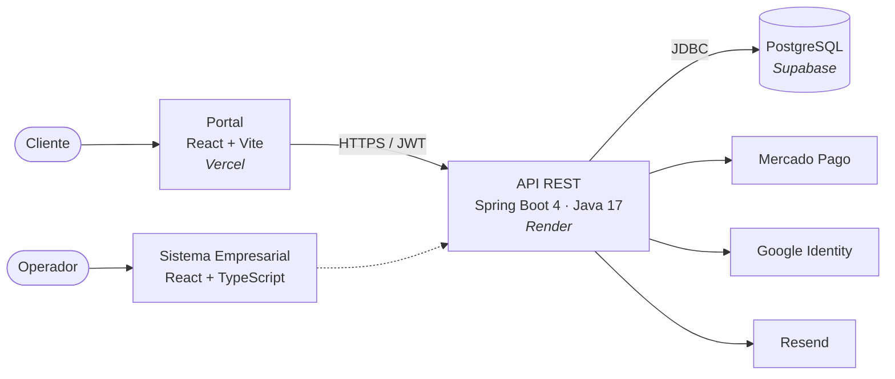

<div align="center">

# 🚌 RutaLibre

### Viaja libre. Compra en segundos.

Plataforma web de venta de pasajes de bus: búsqueda de viajes, reserva, pago en línea y Libro de Reclamaciones virtual.

<br>


[Características](#-características) · [Arquitectura](#-arquitectura) · [Inicio rápido](#-inicio-rápido) · [Libro de Reclamaciones](#-libro-de-reclamaciones) · [Configuración](#-configuración) · [Despliegue](#-despliegue)

</div>

<br>

---

## ✨ Características

| | |
| --- | --- |
| 🔎 **Búsqueda de viajes** | Origen, destino, fecha y horario en tiempo real |
| 🎫 **Reserva y compra** | Selección de asientos y flujo de reserva con sesión firmada |
| 💳 **Pagos en línea** | Integración con Mercado Pago (sandbox y producción) |
| 🔐 **Acceso seguro** | Registro, JWT y acceso con Google |
| 👤 **Perfil del cliente** | Historial de pasajes y datos personales |
| 📖 **Libro de Reclamaciones** | Reclamos y quejas con código correlativo, plazo legal y constancia en PDF |
| 🌗 **Tema claro y oscuro** | Sistema de diseño con tokens compartidos |

<br>

## 🧭 Arquitectura



```text
RutaLibre/
├── backend/             API REST (Spring Boot, JPA, Spring Security)
│   └── sql/             Scripts SQL a ejecutar en Supabase
├── frontend-Portal/     Portal público de clientes
└── frontend-SE/         Sistema Empresarial (interfaz interna)
```

<br>

## 🚀 Inicio rápido

**Requisitos:** Node.js 20+, JDK 17+ y una base PostgreSQL en Supabase.

<details open>
<summary><b>1 · Backend</b></summary>

<br>

Copia `backend/.env.properties.example` como `backend/.env.properties`, completa los valores (ver [Configuración](#-configuración)) y ejecuta:

```bash
cd backend
./mvnw spring-boot:run
```

API disponible en **http://localhost:8080**
</details>

<details open>
<summary><b>2 · Portal</b></summary>

<br>

```bash
cd frontend-Portal
npm ci
npm run dev
```

Abre **http://localhost:5173**
</details>

<details>
<summary><b>3 · Sistema Empresarial</b></summary>

<br>

```bash
cd frontend-SE
npm ci
npm run dev
```
</details>

<details>
<summary><b>🧪 Pruebas</b></summary>

<br>

```bash
cd backend && ./mvnw test
cd frontend-Portal && npm test
```
</details>

<br>

## 📖 Libro de Reclamaciones

Disponible en `/libro-reclamaciones` y enlazado desde el pie de página del portal. Cumple la Ley N.º 29571 (Código de Protección y Defensa del Consumidor) y su reglamento.

- 📝 Formulario guiado de 4 pasos para **reclamos** y **quejas**, sin necesidad de cuenta
- 🔗 Con sesión iniciada: datos prellenados y selección de un pasaje propio
- 🔢 Código correlativo anual **`RL-2026-000001`**, generado de forma atómica en PostgreSQL
- ⏱️ Plazo de respuesta de **15 días hábiles**, calculado con la tabla `feriado`
- 📄 Constancia descargable en PDF
- 🛡️ Consulta protegida con token firmado (`X-Token-Consulta`)
- 🔁 Registro idempotente y límite de envíos por IP
- 🚫 Sin envío automático de correos: toda la información se guarda en base de datos

| Método | Ruta | Descripción |
| :---: | --- | --- |
| `GET` | `/api/reclamos/proveedor` | Datos del proveedor |
| `POST` | `/api/reclamos` | Registra una reclamación (JWT opcional) |
| `GET` | `/api/reclamos/{codigo}` | Consulta con el encabezado `X-Token-Consulta` |

> [!IMPORTANT]
> Antes de usarlo en producción: ejecuta `backend/sql/libro_reclamaciones.sql` en el editor SQL de Supabase, configura las variables `LIBRO_*` en Render y revisa la tabla `feriado` cada año.

<br>

## ⚙️ Configuración

<details>
<summary><b>Backend</b> · Render o <code>backend/.env.properties</code></summary>

<br>

| Variable | Uso |
| --- | --- |
| `DB_URL` `DB_USERNAME` `DB_PASSWORD` | Conexión a Supabase (Transaction Pooler, puerto 6543) |
| `JWT_SECRET` | Firma de tokens de sesión |
| `CORS_ORIGENES` | Orígenes permitidos, separados por coma |
| `RESERVA_TOKEN_SECRETO` | Firma de las sesiones de reserva |
| `RECUPERACION_SECRETO` | Recuperación de contraseña (32+ caracteres) |
| `RESEND_API_KEY` `RESEND_FROM` | Correo de recuperación de contraseña |
| `GOOGLE_CLIENT_ID` | Acceso con Google |
| `DNI_API_TOKEN` | Consulta de DNI |
| `LIBRO_RAZON_SOCIAL` `LIBRO_RUC` | Proveedor del Libro de Reclamaciones |
| `LIBRO_DIRECCION` `LIBRO_TELEFONO` `LIBRO_CORREO` | Contacto del proveedor |
| `LIBRO_MAX_REGISTROS_HORA_IP` | Límite de registros por hora por IP (10 por defecto) |
| `RECLAMOS_SECRETO` | Firma del token de consulta (opcional) |

Las credenciales de Mercado Pago se definen en `application.properties`.
</details>

<details>
<summary><b>Portal</b> · Vercel</summary>

<br>

| Variable | Uso |
| --- | --- |
| `VITE_API_URL` | URL pública del backend |
| `VITE_GOOGLE_CLIENT_ID` | Acceso con Google |
| `VITE_MERCADOPAGO_PUBLIC_KEY` | Clave pública de Mercado Pago |

> [!WARNING]
> Las variables `VITE_*` viajan en el navegador. Nunca incluyas contraseñas ni claves privadas.
</details>

<br>

## ☁️ Despliegue

| Capa | Plataforma | Detalle |
| --- | --- | --- |
| Portal | **Vercel** | Raíz `frontend-Portal`, build `npm run build`, salida `dist`; `vercel.json` redirige a `index.html` |
| API | **Render** | Raíz `backend`, imagen construida con el `Dockerfile` |
| Datos | **Supabase** | PostgreSQL; el backend usa `ddl-auto=validate` |

> [!NOTE]
> El backend no crea ni modifica tablas. Todo cambio de esquema se aplica manualmente desde `backend/sql/`.

<br>

<div align="center">

**RutaLibre** · Hecho en Perú 🇵🇪

</div>
